# Лабораторная работа №6. Система контроля версий

Сначала сделал форк репозитория Kurtyanik/LR6 на GitHub.

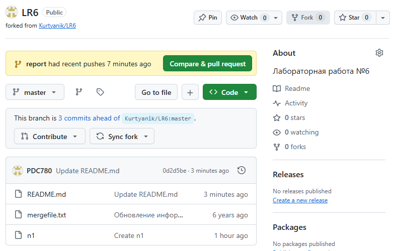

Потом клонировал свой форк на компьютер.

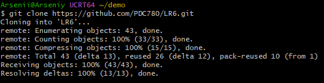

Настроил git: указал имя в формате "группа фамилия И.О." и почту.

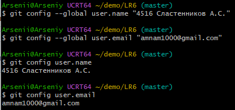

Дальше создал файл web_file_demo.txt прямо на сайте GitHub и сделал коммит.

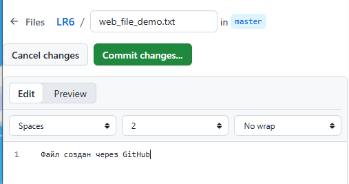

Файл появился в репозитории.

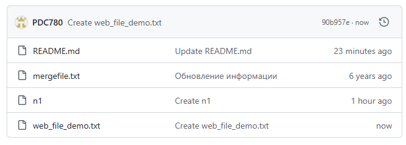

Подтянул изменения к себе командой git pull.

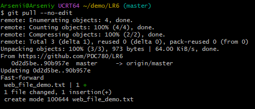

Посмотрел ветки и историю коммитов для branch2 и для master.

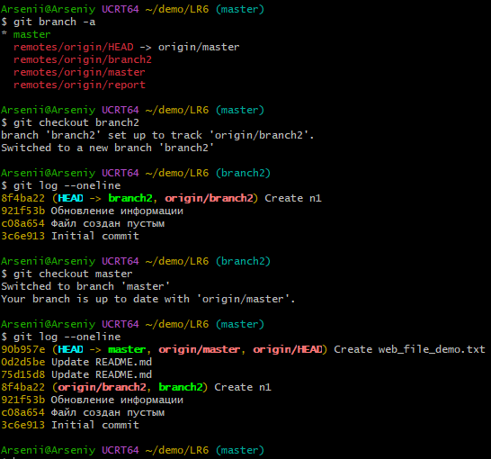

Потом посмотрел общий граф истории.

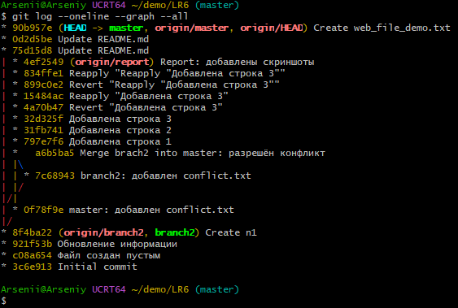

И последние изменения командой git show.

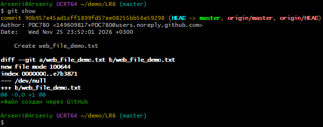

Чтобы получить конфликт, изменил файл conflict.txt в ветке branch2 и в ветке master, а потом слил branch2 в master. Git выдал конфликт.

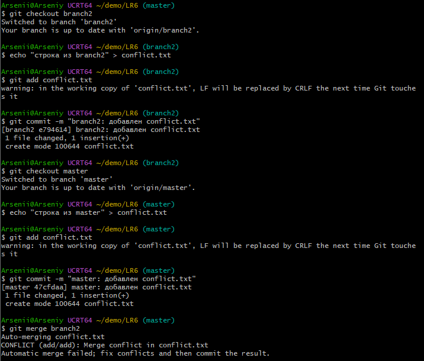

Открыл файл, там стояли маркеры конфликта.

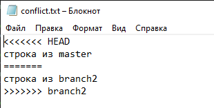

Убрал маркеры, оставил обе строки.

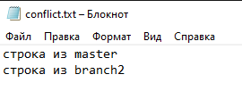

Закоммитил, слияние прошло, в графе видно два родителя.

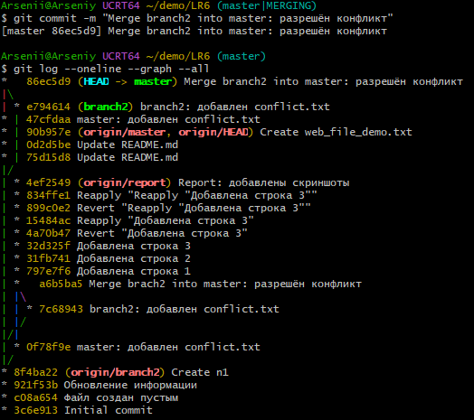

Удалил ветку branch2. Команда git branch -d выдала предупреждение, что ветка не отправлена на GitHub, поэтому удалил через git branch -D.

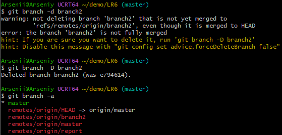

Сделал три коммита с комментариями.

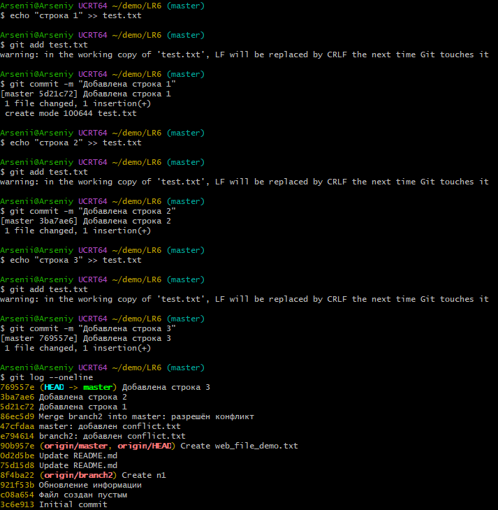

Откатил последний коммит командой git revert, в test.txt остались две строки.

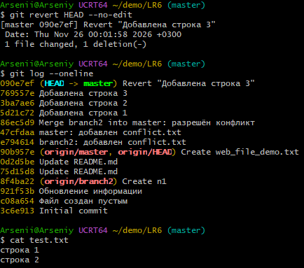

Создал ветку report для отчёта.


Получил историю в нужном формате (хэш, дата, автор, комментарий).

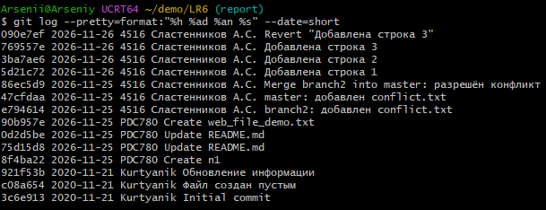

## Лог команд

```
git clone https://github.com/PDC780/LR6.git
cd LR6
git config --global user.name "4516 Сластенников А.С."
git config --global user.email "amnam1000@gmail.com"
git config user.name
git config user.email
git pull --no-edit
git branch -a
git checkout branch2
git log --oneline
git checkout master
git log --oneline
git log --oneline --graph --all
git show
git checkout branch2
echo "строка из branch2" > conflict.txt
git add conflict.txt
git commit -m "branch2: добавлен conflict.txt"
git checkout master
echo "строка из master" > conflict.txt
git add conflict.txt
git commit -m "master: добавлен conflict.txt"
git merge branch2
notepad conflict.txt
git add conflict.txt
git commit -m "Merge branch2 into master: разрешён конфликт"
git log --oneline --graph --all
git branch -d branch2
git branch -D branch2
git branch -a
echo "строка 1" >> test.txt
git add test.txt
git commit -m "Добавлена строка 1"
echo "строка 2" >> test.txt
git add test.txt
git commit -m "Добавлена строка 2"
echo "строка 3" >> test.txt
git add test.txt
git commit -m "Добавлена строка 3"
git log --oneline
git revert HEAD --no-edit
git log --oneline
cat test.txt
git checkout -b report
git branch
git log --pretty=format:"%h %ad %an %s" --date=short
git push --force-with-lease origin report
```

## История коммитов

